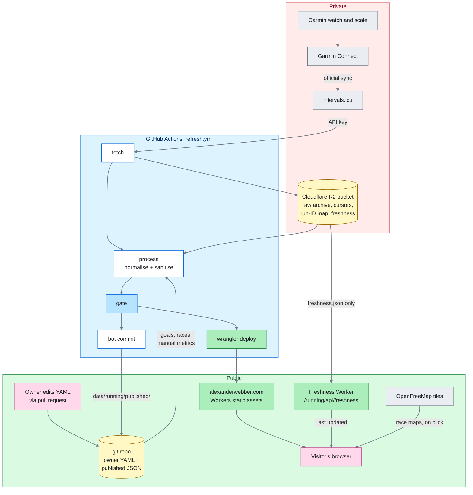
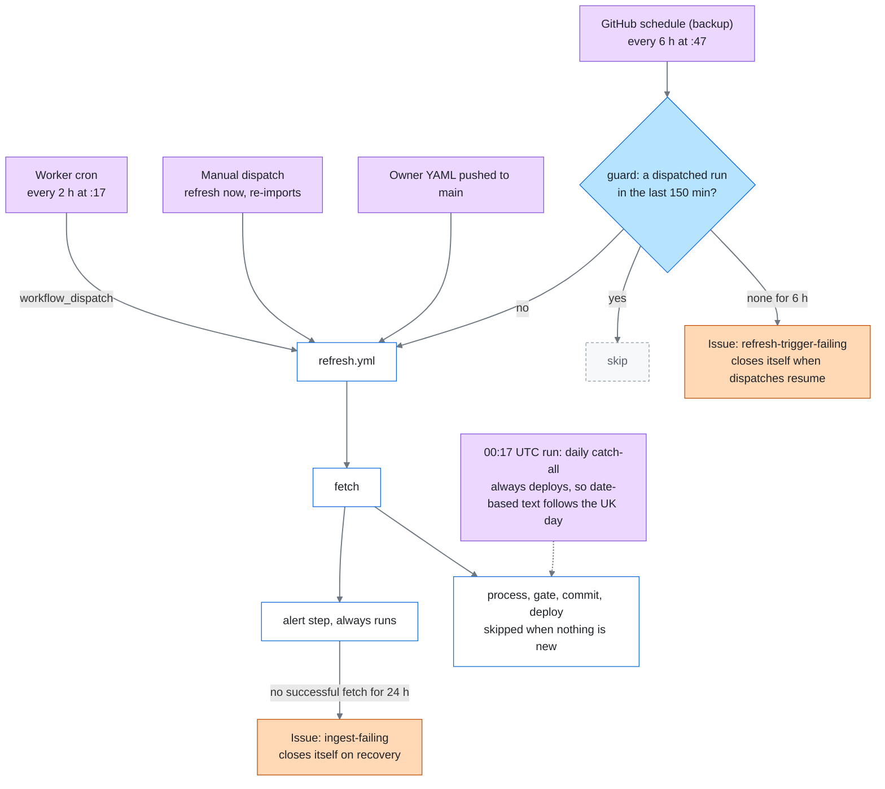
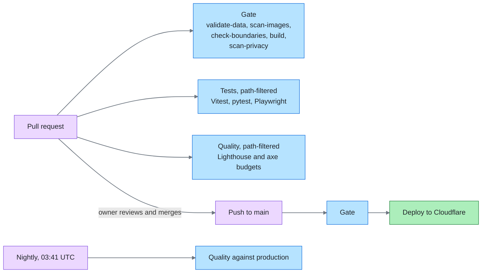

# alexanderwebber.com

Source for [alexanderwebber.com](https://alexanderwebber.com), Alexander Webber's personal site.
The first section, **Running**, follows training for the
[Brighton Marathon](https://alexanderwebber.com/running/) on 4 April 2027 (run for Martlets
hospice): goals, every run, races and PBs, and health and performance metrics, refreshed from a
Garmin watch every two hours. A CV and an AI and software engineering blog come next.

The site was built spec-first with [Spec Kit](https://github.com/github/spec-kit), with AI coding
agents doing the work under a written constitution (see [How it was built](#how-it-was-built)).

- [What's live](#whats-live) · [Architecture](#architecture) · [Tech stack](#tech-stack-and-why)
- [How it was built](#how-it-was-built) · [Privacy](#privacy-by-design) ·
  [Quality](#quality-gates-and-tests) · [Degradation](#graceful-degradation)
- [Costs](#running-costs) · [Repo layout](#repo-layout) ·
  [Local development](#local-development) · [Sources](#data-sources-and-attribution) ·
  [Licence](#licence)

## What's live

| Page | What it shows |
|---|---|
| [Running](https://alexanderwebber.com/running/) | The Brighton countdown and target, featured goals (newly achieved ones first), this week's training, the training build and the latest run |
| [Goals](https://alexanderwebber.com/running/goals/) | Race-time, weight, body-fat and VO2 max goals with progress, the effort that achieved each, and Garmin's predictions |
| [Training](https://alexanderwebber.com/running/training/) | Weekly, monthly and yearly totals, and every run by year |
| Run pages | One per run: pace, heart rate, elevation, cadence and power charts, Garmin heart-rate zones, splits, best efforts and running dynamics |
| [Races](https://alexanderwebber.com/running/races/) | Personal bests (races and any run), race history, and race pages with a route map and photos (the first race is Brighton) |
| [Health](https://alexanderwebber.com/running/health/) | Weight, body fat, VO2 max, race predictions, training status, fitness, fatigue and form, resting heart rate and HRV |

**Next** (see [BACKLOG.md](BACKLOG.md)): charity fundraising (JustGiving), the running journey
story, then the CV & Blog section.

## Architecture

Data flows **ingest → store → render** ([constitution](.specify/memory/constitution.md),
Principle III). Scheduled jobs pull new data into the site's own store, and pages are static HTML
built from it, so no visitor request depends on a third-party API.

The diagrams share one colour key. Zones: red is private, blue is GitHub Actions, green is
public. Boxes: grey for third-party services, amber for data stores, purple for triggers, blue
for checks, green for what's live, orange for alert issues, and pink for people.

### Overview: what's private and what's public



- **Fetch** calls the intervals.icu API for activities and wellness data in a date window and
  archives the raw responses (including each run's original FIT file) in a private R2 bucket.
  Raw data never goes into git.
- **Process** normalises the raw data, removes everything not approved for publishing, gives each
  run an opaque ID, and writes the published JSON. The owner's own files (goals, races, manual
  Garmin readings, overrides) live in git under `data/running/owner/`.
- **The gate** validates and builds the site, and runs the privacy scan (see
  [Quality](#quality-gates-and-tests)). Only if it passes does the bot commit the published files
  to `main` and deploy the build it gated.
- **The site** is static files on Cloudflare Workers. One small Worker answers
  `/running/api/freshness`, so pages can show when data last arrived without a rebuild.

### Refresh triggers and alerts



GitHub's own `schedule` dropped slots and left four-hour gaps, so the two-hourly trigger is a
Cloudflare cron on the site's Worker, and the GitHub schedule is only a backup that watches it.
Runs never overlap (one concurrency group), and a run on any branch but `main` can only fetch.
Detail: [contracts/pipeline.md](specs/001-running-section/contracts/pipeline.md).

### Pull requests and deploys



Every change reaches `main` through a reviewed pull request, except the refresh bot's commits,
which only touch `data/running/published/` and only after the gate passes.

## Tech stack and why

| Choice | Why | Decision |
|---|---|---|
| [Astro](https://astro.build) 7, static output | Pre-built HTML pages, with client JavaScript only where it earns its place (a countdown, a map) | [research R1](specs/001-running-section/research.md) |
| TypeScript | One typed codebase; data types are generated from the JSON Schemas | [plan](specs/001-running-section/plan.md) |
| Build-time SVG charts | No chart library in the browser; every chart has a data table and works without JavaScript | [research R5](specs/001-running-section/research.md) |
| Python ingest (uv, pytest, ruff) | A small, well-tested pipeline package (`awingest`) that runs in Actions | [research R3](specs/001-running-section/research.md), [ingest/README.md](ingest/README.md) |
| JSON Schema | The single schema source, validated in both TypeScript (Ajv) and Python | [research R4](specs/001-running-section/research.md), [schemas/](schemas/README.md) |
| Cloudflare Workers static assets and R2 | Cloudflare's recommended path over Pages; a private bucket for raw data; both inside the free tiers | [research R1, R2](specs/001-running-section/research.md) |
| intervals.icu, not Garmin direct or Strava | An official Garmin sync partner with a personal API key: no unofficial login, no lockout risk. Strava's API terms forbid showing data to others, and it lacks health metrics | [research R0](specs/001-running-section/research.md), [decisions log](PROJECT_MEMORY.md#decisions-log) |
| MapLibre and OpenFreeMap | Open tiles with no API key, loaded only when a visitor opens a race map; a static SVG route shows first | [research R6](specs/001-running-section/research.md) |
| satori and sharp | Share images rendered at build time | [research R8](specs/001-running-section/research.md) |
| Vitest, Playwright, axe, Lighthouse | Unit, end-to-end, accessibility and performance checks | [research R10](specs/001-running-section/research.md) |

## How it was built

The project follows spec-driven development: every feature goes **specify → clarify → plan →
tasks → implement**, using [Spec Kit](https://github.com/github/spec-kit) and the owner's house
standards in [sdd-playbook](https://github.com/alexwebber/sdd-playbook).

- **AI agents did the work.** [Claude Code](https://claude.com/claude-code) agents wrote the
  spec, plan, tasks, code and tests, and ran the process: version checks, CI, deploys, follow-ups
  and handoffs between sessions. The owner made the decisions, through rounds of questions with
  recommended options, and reviewed and merged every pull request.
- **A constitution sets the rules**:
  [`.specify/memory/constitution.md`](.specify/memory/constitution.md). Its eight principles
  cover owning the data, pluggable providers, serverless and gracefully degrading, privacy by
  default, modular sections and an authentic voice (AI may draft, but nothing is published
  without the owner's approval, and nothing is invented). Every plan is checked against it.
- **The Running section's artefacts:** [spec](specs/001-running-section/spec.md),
  [plan](specs/001-running-section/plan.md), [research](specs/001-running-section/research.md),
  [data model](specs/001-running-section/data-model.md),
  [contracts](specs/001-running-section/contracts/README.md),
  [tasks](specs/001-running-section/tasks.md),
  [quickstart](specs/001-running-section/quickstart.md) and the
  [maintainability review](specs/001-running-section/maintainability-review.md) that followed it.
- **Decisions and lessons are written down as they happen**, in
  [PROJECT_MEMORY.md](PROJECT_MEMORY.md), and the general ones go back into the playbook. Nearly
  90 lessons went upstream in three harvests
  ([#10](https://github.com/alexwebber/sdd-playbook/pull/10),
  [#11](https://github.com/alexwebber/sdd-playbook/pull/11),
  [#12](https://github.com/alexwebber/sdd-playbook/pull/12)).

**In figures**, as of 25 October 2026:

| | |
|---|---|
| Main build | 3 days (23–25 Oct 2026): every page, go-live and a refactor, on a spec, plan and foundations from a few shorter sessions earlier in October |
| Requirements | 70 functional requirements, 12 success criteria |
| Tasks | 160 over 9 phases; the 4 still open wait on the owner or a date |
| Pull requests merged | over 70 |
| Tests | 522 Vitest, 408 pytest, 220 Playwright (phone and desktop) |
| Lighthouse (mobile) | 100 for performance and accessibility on every page type |

## Privacy by design

What's public is an explicit list (constitution Principle VI): race results and PBs, training
totals, individual runs, and approved health and performance metrics.

- **GPS maps for races only**, never for training runs. Run pages have a date but no start time,
  and no provider-written titles.
- **Opaque run IDs** (`2026-10-17-ofka`): no intervals.icu or Garmin IDs are ever published. The
  ID map lives in the private bucket.
- **Raw data never enters git.** It stays in private R2; only sanitised files are committed.
- **Sleep, stress and Body Battery stay private**, along with per-run training load.
- **The privacy scan** (`scan-privacy`) checks `data/` and the built site on every build for
  start times, training-run coordinates, provider IDs, unapproved categories and photo metadata.
  Race photos are stripped of all metadata when added, and `scan-images` checks it.

## Quality gates and tests

- **The build gate** runs on every push and every refresh commit: data validation (schemas plus
  cross-file checks), the image and section-boundary checks, `astro check` and the build, then the
  privacy scan. Nothing deploys without it.
- **Tests on pull requests**, path-filtered: Vitest (goals, PBs, best efforts, charts,
  formatting, stores), pytest (adapter, archive, writer and pipeline contracts) and Playwright
  end-to-end tests at phone and desktop widths, with axe accessibility sweeps in light and dark
  mode.
- **Budgets:** Lighthouse mobile performance 90 or more on every page type (landing LCP under
  2.5 s), WCAG 2.2 AA, checked on pull requests and nightly against production.
- **The stale-data drill** builds the site with week-old data and checks that every page still
  renders and says so, with JavaScript on or off and with the freshness endpoint down.

## Graceful degradation

- A failing provider only makes data stale: the last good data stays published and the site
  keeps working.
- Every data page shows when its data was last updated, and a notice when it's more than 12 hours
  old. Without JavaScript, or if the freshness endpoint fails, pages show the build-time value.
- Invalid data fails validation before the build writes anything, so a bad edit never replaces
  the live site.
- Failures open GitHub issues that close themselves on recovery (see
  [Refresh triggers](#refresh-triggers-and-alerts)).

## Running costs

About **$0 a month**: Cloudflare Workers and R2 sit inside their free tiers, and GitHub Actions
inside GitHub Free's minutes. The owner also supports intervals.icu (£9 a quarter), though the
site uses no supporter-only features.

## Repo layout

```text
src/
  pages/              site home and 404
  sections/running/   the Running section: pages, components, domain logic, data store
  shared/             layout, design tokens, charts, formatting, storage machinery, share images
  worker/             the freshness endpoint and the refresh cron
ingest/               awingest, the Python fetch and publish pipeline
schemas/              JSON Schemas for every data file
data/running/
  owner/              owner-entered YAML: goals, races, manual metrics, overrides
  published/          sanitised JSON written by the pipeline
scripts/              gate checks, type generation, Lighthouse budget, photo import
tests/                Vitest, Playwright and accessibility suites, fixtures
specs/                Spec Kit artefacts for each feature
.github/workflows/    gate, tests, quality and refresh
```

Sections are self-contained (Principle VII): `check-boundaries` fails the gate if shared code
imports a section, or one section imports another. More in
[src/sections/running/README.md](src/sections/running/README.md) and
[src/shared/README.md](src/shared/README.md).

## Local development

Needs Node 22 (`.nvmrc`; at least 22.23.4) and, for the pipeline, Python 3.12+ with
[uv](https://docs.astral.sh/uv/).

```text
npm install
npm run dev                  # http://localhost:4321/running/
npm run validate-data        # schemas and cross-file checks
npm test                     # Vitest
cd ingest && uv run pytest   # pipeline tests
```

The full gate, Playwright (which needs a `SHELL_PREVIEW=1` build for its test-only preview
pages), the Lighthouse budget and operating the pipeline are in the
[quickstart](specs/001-running-section/quickstart.md).

## Data sources and attribution

- **Garmin:** running and health data comes from the owner's Garmin devices. Following Garmin's
  brand guidelines, every view of Garmin-sourced data carries a Garmin attribution, naming the
  device where it's known.
- **intervals.icu:** the data reaches the site through the
  [intervals.icu](https://intervals.icu) API, under its API terms. Fitness, fatigue and form are
  intervals.icu's model and are labelled as such.
- **OpenFreeMap and OpenStreetMap:** interactive race maps use
  [OpenFreeMap](https://openfreemap.org) tiles built from OpenStreetMap data, credited on the
  map.

## Licence

The **code** is under the [MIT licence](LICENSE). The **content is not**: the running and health
data under `data/`, race photos, and the written text of the site and its docs are © Alexander
Webber, all rights reserved.
